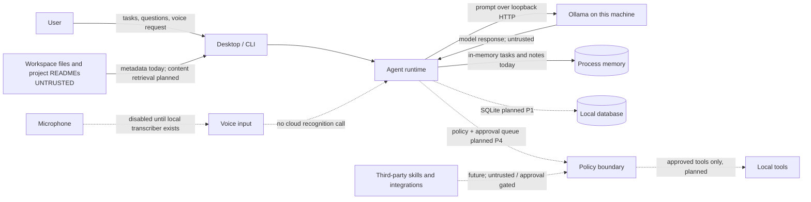

# SigmaHelix threat model v1

**Status:** P0 engineering baseline, 2026-11-02. This is not a security certification.

## Scope and current state

This model covers the imported desktop/console prototype and the planned local-first SigmaHelix v1 boundaries. Today, tasks and notes are in memory; there is no SQLite store, audit chain, approval queue, skills runtime, or external integration. Those planned components are listed as future controls, never as protections that already exist.

The current desktop talks to a local Ollama HTTP endpoint and can launch two fixed workspace projects. The imported speech code previously sent recorded audio to Google's recognition service. P0-007 removed that network call; voice input now stays disabled unless a local transcriber is injected. The unused model selector contained hosted-model behavior and was moved out of the application package. Ollama endpoint configuration now accepts loopback URLs only.

## Security objectives

- Keep personal and career data on the machine.
- Treat project files, job descriptions, model output, and future plugin content as untrusted data.
- Do not let model output directly authorize a consequential action.
- Preserve durable state and provide a verifiable record once persistence is added.
- Fail closed when model, plugin, integration, or policy state is unclear.

## Assets and trust boundaries

| Asset | Class | Current location/state | Main concern |
|---|---|---|---|
| Tasks, notes, plans | S1 personal | In memory today; SQLite planned | Loss, disclosure, or unauthorized edits |
| Resume, career facts, salary constraints | S2 sensitive | Not yet implemented in the app | Fabrication, disclosure, or incorrect durable memory |
| API keys and OAuth tokens | S3 secret | No integration credentials in the app today | Plaintext storage or prompt/log leakage |
| Local model weights and prompts | Local operational data | Ollama and app process | Endpoint spoofing, prompt injection, resource exhaustion |
| Workspace repositories and documents | Untrusted input | `Career/cloned_repos/` | Malicious instructions, path tricks, unsafe launch targets |
| Backup archive | S1/S2 workspace copy | Separate physical disk `/dev/sda2` | Local theft or unintended access; archive is not encrypted |
| Audit/approval records | Required future asset | Not implemented | Repudiation and approval replay |

Trust boundaries exist between the user and imported content; the app process and local model server; the app and the filesystem; and, in future gates, the app and third-party skills/integrations. Loopback limits the model destination to this machine but does not authenticate the process listening there.

## Data-flow diagram

Dashed edges are planned or disabled, not current capabilities. The current loopback Ollama service has no app-level authentication, so a hostile local process could impersonate it or read requests if it can bind the configured port first.

## STRIDE analysis

| Category | Threat in SigmaHelix | Current control / gap | Required control and gate |
|---|---|---|---|
| **Spoofing** | A process impersonates local Ollama and returns attacker-controlled model output. | Endpoint is restricted to loopback; the app does not authenticate the Ollama process. | Verify local service identity where supported; validate responses; fail closed on malformed output (P3). |
| **Tampering** | A malicious repository changes files or embeds instructions that alter agent behavior. | Project listing is metadata-only today. Content retrieval and skill loading are not active. | Tag retrieved content as untrusted; hash and validate skill manifests; confine filesystem paths (P3/P4). |
| **Repudiation** | A user or agent denies a tool action, approval, or data change. | No durable audit chain or approvals exist yet. | Append-only hash-chained audit records, payload-bound approvals, replay/expiry tests (P1/P4). |
| **Information disclosure** | Prompts or audio leave the machine; credentials enter logs or memory. | Ollama destinations now require loopback. Google speech recognition was removed; voice input is disabled until a local transcriber is configured. Secret redaction/keyring are not implemented because integrations are not present. | Keep all model endpoints local; add secret redaction and OS keyring before credentials (P1/P6). |
| **Denial of service** | Huge prompts, stuck models, repeated retries, or recursive work exhaust CPU/GPU/disk. | Ollama calls have timeouts; no step budget, GPU-residency guard, scheduler limits, or database quotas yet. | Bounded context/retries/steps, cancellation, GPU guard, and resource limits (P1/P3/P4). |
| **Elevation of privilege** | Model output or a plugin starts an unintended command or writes externally. | Current launchers use fixed argument arrays, but the policy engine and approval queue are absent. No `shell=True` path was found in the imported app. | Deny by default; bind R2/R3 approval to exact payload; sandbox skills; require previews (P2/P3/P4). |

## Abuse cases

| ID | Actor and attempt | Impact | State and required response |
|---|---|---|---|
| A01 | A project maintainer places “ignore prior instructions” in a README that Tommy later retrieves. | Agent instruction override or unauthorized tool request. | Retrieval is not active in this prototype. Treat all retrieved text as untrusted; run the plan’s 40-payload injection suite before P4 claims. |
| A02 | A user or environment file points `OLLAMA_HOSTS` at a public server. | Career prompts and personal data could be sent off-device. | Fixed in P0-007: only credential-free localhost/loopback HTTP(S) URLs are accepted; regression tests reject remote and ambiguous URLs. |
| A03 | A voice request is transcribed through `recognize_google`. | Recorded speech is uploaded to a third party without local-only consent. | Fixed in P0-007: the Google call is removed. Voice input reports unavailable until an offline transcriber exists; tests assert no microphone probe or Google call occurs by default. |
| A04 | Malware binds the loopback Ollama port before the expected service starts. | It can read prompts or return malicious JSON. | Residual risk: loopback is not process authentication. Bind only to loopback, validate model output, and verify service identity where possible (P3). |
| A05 | A crafted project manifest uses `../`, a symlink loop, or a huge directory tree. | Reads outside allowed roots, hangs scanning, or blocks the UI. | Scanner is metadata-only today. Resolve and confine paths; impose scan limits and test traversal/loop/permission cases (P2). |
| A06 | Prompt text asks Tommy to launch a project whose startup file has been replaced. | Local code execution under the user account. | Current launcher paths are fixed but launch profiles/preview/approval are absent. Do not treat model intent as authorization; add profile allowlists and risk approval (P2/P4). |
| A07 | An unsigned skill requests broad tools or embeds a prompt override. | Persistent prompt injection or code execution. | No skill runtime is active. P3 requires hash/signature checks, sandbox probes, risk ceilings, quarantine, and human approval for third-party installs. |
| A08 | A future integration token is placed in YAML, SQLite, a prompt, or a crash log. | Credential theft or external account compromise. | No integration credentials are present. Before P6, use OS keyring storage, redaction, secret scanning, rotation, and read-only scopes first. |
| A09 | A local process edits the future database or deletes audit rows. | State corruption and loss of evidence. | State is in memory today. P1 requires migrations, backups, hash-chained audit verification, crash recovery, and tamper detection. |
| A10 | A future inbound webhook is forged or replayed to create false career evidence or trigger work. | False durable facts or unauthorized actions. | No webhook integrations exist. Require signature validation, replay protection, source allowlists, and human review before evidence enters memory (P6/P4). |

## P0-007 changes and remaining risks

Implemented with this model:

1. Loopback-only URL validation for Ollama endpoints, with tests for localhost, IPv4/IPv6 loopback, remote hosts, and URL ambiguity.
2. Removal of cloud speech recognition. Voice input stays unavailable until a local transcriber can be supplied.
3. Quarantine of the unused hosted-model selector outside the active application package.
4. Restriction of the P0-001 backup archive and manifest to owner-only permissions (`0600`; containing directory `0700`). The archive remains unencrypted and is on a local second physical disk.

The local model server, operating-system account, and kernel are trusted dependencies. A compromised local user account or administrator is out of scope; filesystem permissions reduce accidental access but do not defend against that level of compromise. No deployment or security certification is claimed.
